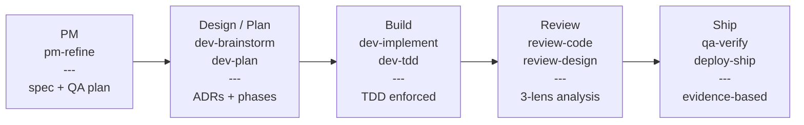
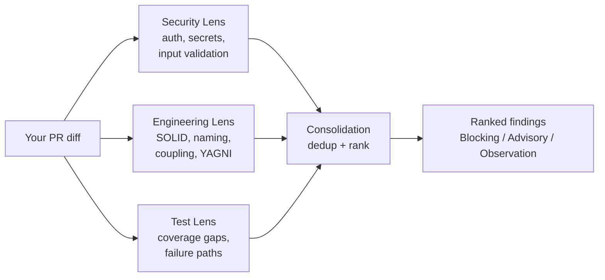

# enggenie

> "every skill is a domain expert that activates when you need it and stays silent when you don't."

Role-based AI skills that cover the full software development lifecycle - from vague idea to shipped PR - without letting your AI cut corners.

---

**Without enggenie:**
```
You: "Add a user profile feature."
AI: Writes 200 lines of code. No plan. No tests. No review.
You: Spend 3 days in review cycles, find 2 bugs in QA, rewrite 30% after spec ambiguity.
```

**With enggenie:**
```
You: "Add a user profile feature."
→ pm-refine creates a spec with requirements, edge cases, and a QA plan
→ dev-plan phases the work into independently deployable chunks
→ dev-implement enforces TDD - failing test before any code, green before moving on
→ review-code runs security, engineering, and test lenses in parallel (new in v3.0.0)
→ qa-verify requires actual evidence before any "done" claim
→ deploy-ship creates the PR with full spec context for your reviewers

Result: Ships clean. Tests prove it. Your team can read what was built and why.
```

---

## What it looks like

Here is a compressed real session. The project is a Next.js + TypeScript + Firebase heist-themed game. The task: add a player inventory system.

**Step 1 - dev-implement writes a failing test first:**

```typescript
// src/services/inventory/player-inventory.test.ts
import { addItemToInventory, getInventory } from './player-inventory';
import { db } from '@/lib/firebase';

vi.mock('@/lib/firebase');

describe('player inventory', () => {
  it('adds an item and returns updated inventory', async () => {
    const mockGet = vi.fn().mockResolvedValue({ exists: () => false });
    const mockSet = vi.fn().mockResolvedValue(undefined);
    (db.collection as vi.Mock).mockReturnValue({
      doc: () => ({ get: mockGet, set: mockSet }),
    });

    const result = await addItemToInventory('session-abc', 'lockpick');

    expect(mockSet).toHaveBeenCalledWith(
      expect.objectContaining({ items: ['lockpick'] })
    );
    expect(result.items).toContain('lockpick');
  });
});
```

```
$ npx vitest run src/services/inventory/player-inventory.test.ts

 FAIL  src/services/inventory/player-inventory.test.ts
   Cannot find module './player-inventory'

Test Files  1 failed (1)
Tests       0 failed | 0 passed | 1 skipped
Duration    312ms
```

RED. Test exists. Implementation does not. That is the correct order.

**Step 2 - minimal implementation:**

```typescript
// src/services/inventory/player-inventory.ts
import { db } from '@/lib/firebase';

export async function addItemToInventory(sessionId: string, item: string) {
  const ref = db.collection('sessions').doc(sessionId);
  const snap = await ref.get();
  const current = snap.exists() ? (snap.data()?.items ?? []) : [];
  const updated = [...current, item];
  await ref.set({ items: updated }, { merge: true });
  return { sessionId, items: updated };
}

export async function getInventory(sessionId: string) {
  const snap = await db.collection('sessions').doc(sessionId).get();
  return snap.exists() ? snap.data()?.items ?? [] : [];
}
```

```
$ npx vitest run src/services/inventory/player-inventory.test.ts

 PASS  src/services/inventory/player-inventory.test.ts
   player inventory
     ✓ adds an item and returns updated inventory (23ms)

Test Files  1 passed (1)
Tests       1 passed (1)
Duration    287ms
```

GREEN.

**Step 3 - review-code security lens flags something:**

```
[Security Lens] BLOCKING: addItemToInventory accepts arbitrary item strings
with no validation against a known-item allowlist. A malicious client could
inject item: "<script>alert(1)</script>" or item: "admin_key" into any
session. Add an ITEMS_ALLOWLIST constant and validate before writing.

Severity: Blocking - do not merge without fixing.
```

The implementer adds the allowlist and a test for the rejection case before proceeding.

**Step 4 - qa-verify requires proof:**

```
$ npx vitest run --reporter=verbose

 PASS  src/services/inventory/player-inventory.test.ts (3 tests)
 PASS  src/components/InventoryPanel.test.tsx (7 tests)
 PASS  src/app/api/inventory/route.test.ts (4 tests)

Test Files  3 passed (3)
Tests       14 passed (14)
Duration    1.84s
Exit code: 0
```

```
qa-verify: 14 tests passed, exit 0. Coverage: inventory module 94%.
Completion claim is substantiated. Proceeding to deploy-ship.
```

---

## How it works



Each node is a role with dedicated skills and a concrete output artifact. The PM hands off to Dev for design and planning. Dev builds and hands off to the Reviewer. The Reviewer hands off to QA and Ship. When different people handle different phases, a Jira ticket carries the context between sessions automatically.

---

## The skills

| Role | Skill | What It Does | What You Get | Try Saying... |
|------|-------|-------------|--------------|---------------|
| **PM** | `pm-refine` | Generates specs, refines stories, estimates points | `enggenie/spec_*.md` with requirements, edge cases, QA plan | "Write a spec for player inventory" |
| **Dev** | `dev-brainstorm` | Brainstorms approaches, writes architecture decision records | `enggenie/adr_*.md` with options, decision, consequences | "What's the best way to handle timer sync?" |
| **Dev** | `dev-plan` | Creates phased implementation plans | `enggenie/plan_*.md` with tasks, dependencies, readiness checks | "Create a plan from this spec" |
| **Dev** | `dev-implement` | Executes plans with TDD subagents | Code, tests, per-task commits with spec traceability | "Execute Phase 1 of the plan" |
| **Dev** | `dev-tdd` | Enforces RED-GREEN-REFACTOR on every change | Failing test, then implementation, then refactor | "Add a validateSessionCode function" |
| **Dev** | `dev-debug` | 4-phase systematic root cause investigation | Root cause + targeted fix + regression test | "This Firebase listener is firing twice" |
| **Reviewer** | `review-code` | 3-lens parallel review: security, engineering, test | Ranked findings: Blocking / Advisory / Observation | "Review my changes before I push" |
| **Reviewer** | `review-design` | Checks UI against design system, states, a11y | Compliance report with specific gaps | "Does this match the Figma?" |
| **QA** | `qa-verify` | Requires evidence before any completion claim | Test run output with exit code and counts | "Are we done? Prove it." |
| **QA** | `qa-test` | Playwright automation + manual browser testing | Test scripts + annotated screenshots | "Test the heist session join flow" |
| **Dev** | `dev-commit` | Analyzes diffs, proposes conventional commit messages | Conventional commit ready to stage | "Commit this" |
| **Deploy** | `deploy-ship` | PR creation, Jira handoff updates, branch completion | Open PR with spec context and dev notes | "Create a PR for this branch" |
| **Memory** | `memory-recall` | Cross-session context with 10x token savings | Summary of prior decisions and patterns | "What pattern did we use for auth tokens?" |
| **Gateway** | `enggenie` | Routes to the right skill when intent is ambiguous | Correct skill activates for your context | "Help me work on PROJ-1234" |

---

## Why teams adopt it

### For Engineering Managers

Code review quality is inconsistent by nature - it depends on who is reviewing that week, whether they caught the auth issue, whether they noticed the missing test coverage. With enggenie, every PR gets the same three lenses regardless of team composition. Security, engineering principles, and test coverage are checked on every diff. Review quality stops being a function of who happened to have bandwidth.

### For Developers

"I always say I'll write tests first. I almost never do when I'm under pressure." `dev-tdd` removes the option. It will not move forward until the test is red. That constraint turns out to be useful when you're under a deadline - the pressure to just write the code is real, and having a tool that won't let you is a surprisingly effective forcing function.

### For PMs

The spec is complete but what ships is subtly different - missing an edge case, handling one AC differently than intended. `pm-refine` forces edge cases and acceptance criteria to be explicit before dev starts. The Jira handoff writes your spec into the ticket directly, so the developer reads what you wrote - not a summary someone typed from memory two days later.

---

## Multi-lens code review (new in v3.0.0)

Every code review runs three specialized lenses in parallel, then consolidates findings with deduplication and ranking.



**Finding severity levels:**
- **Blocking** - must fix before merge (security vulnerabilities, missing test coverage for critical paths, API contract violations)
- **Advisory** - should fix in this PR or immediately after (naming, coupling issues, missing edge case tests)
- **Observation** - worth knowing, no action required now

**Round 2+ etiquette:** on subsequent review rounds, lenses only raise new or worsened findings. If a finding was raised in round 1 and the author chose not to act on it, lenses do not relitigate it. This keeps review cycles from becoming arguments.

---

## Quick start

```bash
# Works with Claude Code, Cursor, GitHub Copilot CLI, Gemini CLI, OpenCode, and more
npx skills add badrusiddique/enggenie-skill
```

Expected output:
```
Detecting installed AI coding tools...
  ✓ Claude Code detected
  ✓ Cursor detected

Installing enggenie-skill (14 skills)...
  ✓ pm-refine
  ✓ dev-brainstorm
  ✓ dev-plan
  ✓ dev-implement
  ✓ dev-tdd
  ✓ dev-debug
  ✓ review-code
  ✓ review-design
  ✓ qa-verify
  ✓ qa-test
  ✓ dev-commit
  ✓ deploy-ship
  ✓ memory-recall
  ✓ enggenie (gateway)

Installed to: ~/.claude/skills/enggenie/  (Claude Code)
              ~/.cursor/skills/enggenie/   (Cursor)

Done. Skills activate automatically based on your intent.
```

**Claude Code native (no Node.js required):**
```
/plugin marketplace add badrusiddique/enggenie-skill
/plugin install enggenie@badrusiddique-enggenie-skill
/reload-plugins
```

For platform-specific guides, see:
- [Claude Code](docs/getting-started/claude-code.md)
- [Cursor](docs/getting-started/cursor.md)
- [GitHub Copilot CLI](docs/getting-started/copilot-cli.md)
- [Google Gemini CLI](docs/getting-started/gemini-cli.md)
- [OpenCode.ai](docs/getting-started/opencode.md)

---

## What makes enggenie different

| | Generic AI prompting | enggenie |
|--|---------------------|----------|
| Code review | One response, one perspective | 3 parallel lenses: security, engineering, test |
| Testing | Writes tests if you ask | Refuses to write code without a failing test first |
| Completion claims | "Tests should pass" | Requires actual exit codes and test counts as proof |
| Context between sessions | Starts fresh every time | Jira handoff bridges PM to Dev to QA |
| Debugging | Guesses until it works | 4-phase investigation: observe, pattern, hypothesis, fix |
| Estimation | "This should take a few days" | T-shirt sizing with explicit complexity reasoning |
| Platform | One tool | Claude Code, Cursor, Copilot CLI, Gemini CLI, OpenCode |

---

## Cross-session handoffs via Jira (optional - requires Atlassian MCP)

When different people handle different phases, the Jira ticket becomes the context bridge between roles:

```
PM runs pm-refine
  → Writes "For Dev" and "For QA" sections to the Jira ticket

Dev picks up the ticket
  → Reads PM's handoff context, builds the feature
  → Writes "Dev Handoff" comment (PR link, what was built, QA focus areas)

QA picks up the ticket
  → Reads PM's "For QA" + Dev's "Dev Handoff"
  → Writes "QA Results" comment (pass/fail, bugs found, coverage)
```

Any skill can be picked up cold - just reference the Jira ticket and enggenie reads the full chain of context from previous roles. When Jira MCP is not available, handoff context saves to spec files instead.

---

## Real-world scenarios

| Scenario | What You Say | Skill That Activates |
|----------|-------------|---------------------|
| PM drops a vague feature request | "Write a spec for heist session timer" | `pm-refine` |
| Choosing between approaches | "Server-side vs client-side timer - tradeoffs?" | `dev-brainstorm` |
| Sprint planning breakdown | "Create an implementation plan from this spec" | `dev-plan` |
| Writing new code from scratch | "Add a validateSessionCode function" | `dev-tdd` |
| Executing a plan | "Execute Phase 1 of the implementation plan" | `dev-implement` |
| Test failure investigation | "This Firebase listener is firing twice" | `dev-debug` |
| Pre-PR review | "Review my changes before I push" | `review-code` |
| Checking implementation vs Figma | "Does this match the design?" | `review-design` |
| Pre-PR sanity check | "Are we done? Prove it." | `qa-verify` |
| Playwright automation | "Test the session join flow" | `qa-test` |
| Committing staged changes | "Commit this" | `dev-commit` |
| Creating a PR | "Create a PR for this branch" | `deploy-ship` |
| Recalling past decisions | "What pattern did we use for auth tokens?" | `memory-recall` |
| Don't know where to start | "I need to work on PROJ-1234" | `enggenie` (gateway) |

---

## Documentation

- New to enggenie? Start at [docs/getting-started/](docs/getting-started/)
- Adopting as a team? See [docs/guides/adopting.md](docs/guides/adopting.md)
- Customizing for your team? See [docs/guides/team-setup.md](docs/guides/team-setup.md)
- Building your own skills? See [docs/guides/writing-custom-skills.md](docs/guides/writing-custom-skills.md)
- Worked examples? See [docs/examples/](docs/examples/)
- How sessions hand off? See [docs/guides/how-it-works.md](docs/guides/how-it-works.md)

---

## Plugin discovery

| Directory | Platforms | URL |
|-----------|----------|-----|
| skills.sh | All (18+ tools) | [skills.sh](https://skills.sh) |
| ClaudePluginHub | Claude Code | [claudepluginhub.com](https://www.claudepluginhub.com) |
| Gemini Extensions Gallery | Gemini CLI | [geminicli.com/extensions](https://geminicli.com/extensions/) |
| Cursor Marketplace | Cursor | [cursor.com/marketplace](https://cursor.com/marketplace) |
| SkillsMP | All | [skillsmp.com](https://skillsmp.com) |

---

## Contributing

See [CONTRIBUTING.md](CONTRIBUTING.md). We welcome contributions - especially new reference docs, platform adapters, and bug reports.

## License

[MIT](LICENSE)

---

Built by [Badru Siddique](https://github.com/badrusiddique).
